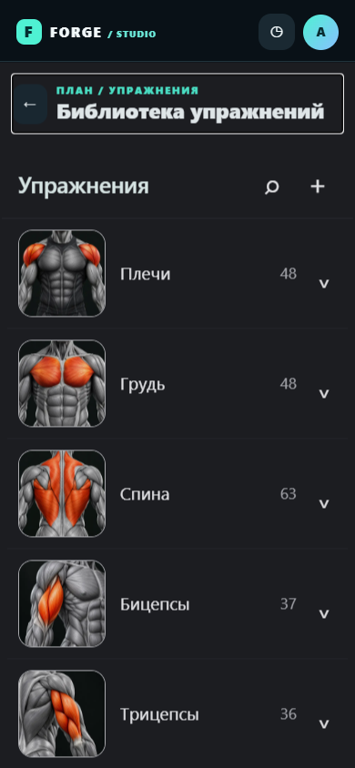
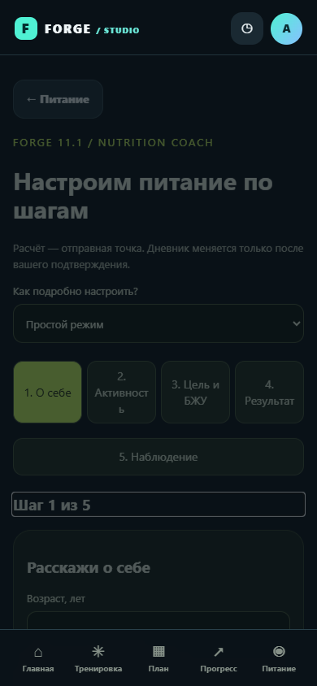

# Навигация FORGE 11.1.1 — проверка 2026-11-02

База: `nutrition-coach-11-1`, коммит `01e432b8c0eeb59e1a0430ebc1450bdb13880717`. Ветка исправлений: `fix-navigation-11-1`. Nutrition Coach 11.1 и модель пользовательских данных сохранены.

## Воспроизведённые причины

1. Основной контейнер `.app` имеет `min-height:100vh`, но вторичные секции `library`, `foodcatalog`, `meals`, `cycles` были его соседями в body, после контейнера. Когда основные страницы скрывались, пустая `.app` продолжала занимать экран. В Chromium 390×844 библиотека начиналась на y≈844–846 при scrollY=0. Это не сохранённая прокрутка. Координатор помещает вторичные страницы внутрь существующей `.app`: теперь библиотека начинается на y=68 под шапкой. Отрицательных отступов и компенсационных пустых блоков нет.
2. Цепочка f6/n8/n9/Coach не знала о `y8DetailBack` и других карточках x7. Воспроизведение: открыть карточку на главной → старый `f6HandleAndroidBack()` возвращает `exit`, карточка остаётся открытой. Кроме того, f6 хранил единственного родителя вместо истории. Kotlin трактовал отсутствие JS-функции как `exit` и вызывал `finish()`.

## Решение

- `navigation.js` — общий координатор showPage, f6Go, f6Back, Android Back, Escape и кнопок возврата. История ограничена 40 записями; повтор текущего экрана не добавляется, возврат прямой ссылкой к уже посещённому разделу сокращает цикл. Переход на главную очищает внутренний путь.
- Новая страница открывается сверху. Перед переходом фиксируется ввод в активном поле, включая вес подхода. Возврат восстанавливает прокрутку, поля, поиск/группу библиотеки, вкладку/период статистики, анкету Coach. При закрытии карточки библиотека не перерисовывается.
- Реестр поверхностей выбирает верхний видимый диалог по z-index и порядку открытия. Карточки x7/y8, стандартные модальные окна, настройки n9, редактор/день/выбор упражнений n8 обрабатываются раньше страниц. Несохранённые изменения редактора требуют подтверждения выхода.
- Навигационный кэш `forge_navigation_v1` отделён от `forge_v2`: пользовательские данные не очищаются. При пересоздании Activity загружается доверенный локальный HTML, затем восстанавливается кэш. Черновик редактора восстанавливается через существующую модель редактора; HTML из хранилища не исполняется. При недействительном кэше — главная.
- Браузер использует один служебный history entry и popstate, делегирующий действие той же внутренней истории. Это ограничивает рост history и исключает двойной Back. Браузерный Forward не является повторным открытием внутренних экранов. При исчерпании внутренней истории Back покидает документ обычным способом.
- AndroidX OnBackPressedDispatcher получает заранее известное состояние JS через мост. При готовой главной без внутренних экранов callback отключён: системный Back/predictive back-to-home остаётся системе. Загрузка, отсутствие функции, неопределённый ответ или исключение JS не закрывают Activity. Повторное действие во время асинхронного ответа блокируется. История WebView проверяется только для другого документа, не для pushState того же HTML.
- Insets системных панелей/IME применяются к контейнеру WebView, а не как padding внутри WebView. Открытая клавиатура имеет приоритет над внутренним переходом. Нет обработчика касаний по краю экрана и нет имитации системного жеста.
- Высота нижней панели измеряется; контент получает соответствующее место снизу. Новому экрану/диалогу передаётся фокус, скрытые страницы и фон диалога inert, заголовок документа отражает раздел. Базовый дизайн сохранён.

## Проверки

`npm test`: прежние 61 unit-тест Coach, E2E Coach, 18 сценариев дневника, каталог 556 упражнений, локальные ресурсы и синтаксис; дополнительно `scripts/navigation-browser.cjs`.

Новая навигация проверяется при 360×800, 390×844, 412×915. Для каждого размера: A–J, браузерный Back, карточка на главной, отказ от потери черновика, цепочка редактор → день → выбор → назад, повторные открытия, восстановление после reload, вкладка массы/период статистики. Проверяется отсутствие горизонтального переполнения и ошибок JS. Поворот — изменение viewport; увеличенный шрифт — CSS-текст 20px, **не системная настройка Android**.

| Экран/поверхность | Автоматически проверено в браузере | Ограничение |
|---|---|---|
| Главная, программы | Открытие, последовательность Back, повторный вход | Физический жест не проверен |
| Редактор программы, день, выбор упражнения | Черновик после reload, отмена выхода, возврат по уровням | Все комбинации редакторских действий не исчерпаны |
| Активная тренировка | Back сохраняет черновик; прежние тесты подходов/истории проходят | Фон/убийство процесса Android не проверены |
| Каталог, карточки | Положение под шапкой, поиск/группа, закрытие, возврат/прокрутка | Проверены представительные карточки |
| История, статистика, масса | Открытие, повторный вход, вкладка массы и период после reload | Реальный системный шрифт не проверен |
| Силовые калькуляторы | Открытие/возврат; прежние расчёты 1ПМ/5ПМ | Жест на устройстве не проверен |
| Питание, продукты, рецепты | Открытие/повторный вход/ширина; прежнее сохранение/экспорт | Камера и внешние сервисы не проверены |
| Nutrition Coach | Возврат к питанию, шаги, сохранение целей и анкеты | Восстановленная оценка требует пересчёта |
| Профиль, настройки | Открытие, верх страницы, повторный вход/ширина | Полный аудит доступности не выполнен |
| Диалоги | Back закрывает окно, а не страницу; защита редактора | Не все варианты нативных prompt/confirm протестированы |

Android: `:app:assembleDebug :app:testDebugUnitTest :app:lintDebug :app:assembleDebugAndroidTest`. Инструментальные тесты `NavigationBackTest` компилируются: системная кнопка Back по цепочке, JS-ошибка без закрытия, пересоздание Activity. **Они не выполнены**: `adb devices` пуст, эмулятор отсутствует. Kotlin JVM unit-тестов нет (NO-SOURCE). Локальная сборка успешна, lint: 0 ошибок / 26 предупреждений, включая 4 уведомления о новых версиях тестовых библиотек и API33-only атрибут predictive Back.

## Проверка на телефоне

1. Экспортировать JSON через существующие настройки резервного копирования. Скачать APK 11.1.1 (versionCode15). Открыть его и выбрать обновление, не удаляя установленную версию. Подпись должна совпадать; при отказе установки не удалять приложение.
2. Главная → программы → библиотека → карточка. Свайпы Back: закрыть карточку → программы → главная. Повторить экранной/аппаратной кнопкой Back.
3. Проверить поиск/группу библиотеки и прокрутку после возврата, затем питание → Coach → назад. На поздних шагах Coach сначала возвращается предыдущий шаг.
4. Открыть редактор, изменить поле, отказаться от выхода; открыть клавиатуру — первый Back должен скрыть её. Проверить поворот и повторное открытие после сворачивания.
5. Записать подход активной тренировки, перейти назад и открыть тренировку снова. Проверить сохранность веса/повторов. Открыть модальное окно поверх неё — Back должен закрыть только окно.
6. На тестовом эмуляторе/устройстве выполнить `gradlew connectedDebugAndroidTest`. Отдельно вручную проверить завершённый и отменённый крайний свайп на Android 13/14/15/16, три кнопки, IME, TalkBack, большой системный шрифт, вырезы/панели и пересоздание/убийство процесса. Автоматический pressBack не доказывает predictive gesture.

Сборка не является подтверждением физической работы Android Back. Нативная интерактивная анимация перехода между HTML-страницами не реализована; системная анимация выхода с корневого экрана делегирована Android.

Официальные основания: [Android predictive Back](https://developer.android.com/guide/navigation/custom-back/predictive-back-gesture), [WebView и AndroidX Back](https://codelabs.developers.google.com/handling-gesture-back-navigation). В main изменения не объединяются.
