# FORGE v2 · сравнение интерфейса

Снимки получены из приложения в Chromium с одним синтетическим дневником и фиксированной датой 16 ноября 2026. Исходная версия — 11.4.3, `497ca76`. Изменения — ветка `forge-ux-ergonomics-v2`, проверочная версия 11.4.4. Изображения представлены фактическим рендером HTML, CSS и JS приложения.

## Продукты

| Ширина | До | После |
|---|---|---|
| 320 px | 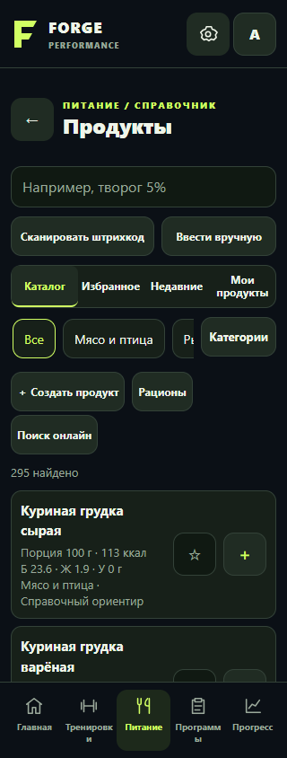 | 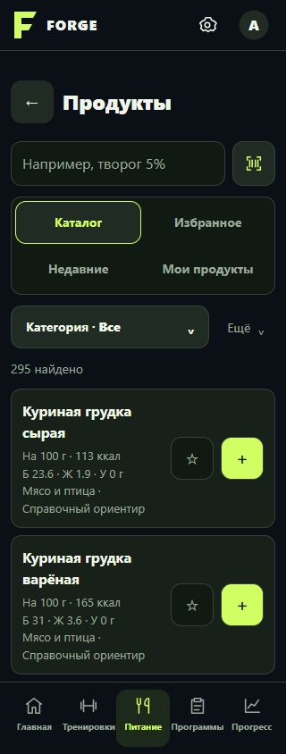 |
| 360 px | 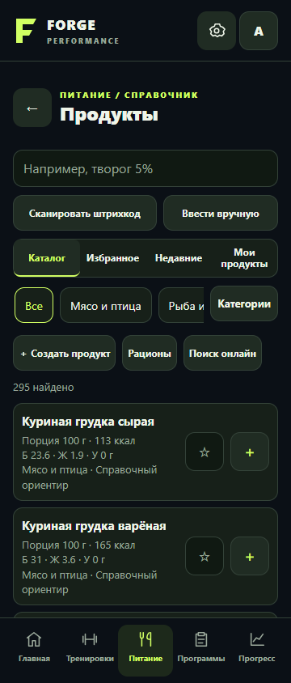 | 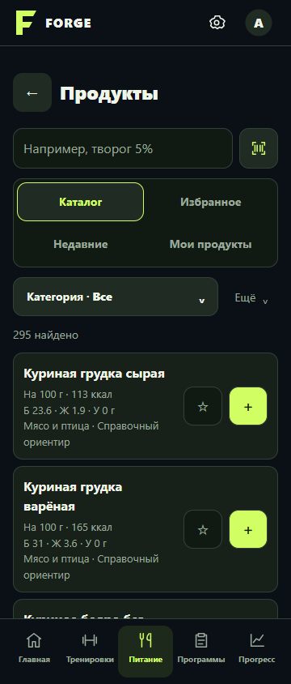 |
| 390 px | 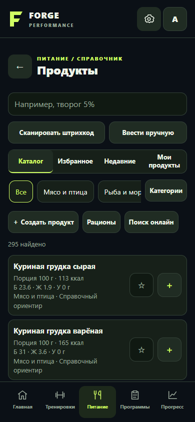 | 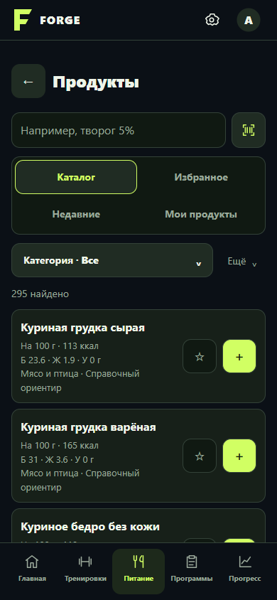 |
| 412 px | 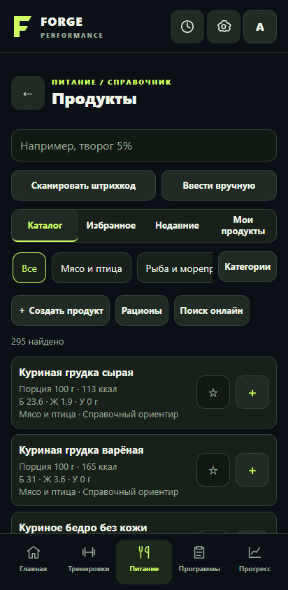 | 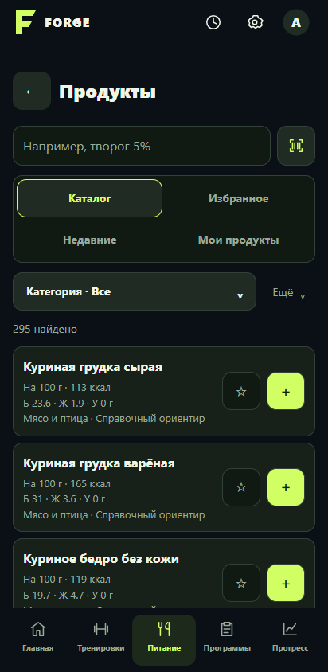 |

| Измерение | 320 | 360 | 390 | 412 |
|---|---:|---:|---:|---:|
| Высота шапки до → после, px | 76 → 57 | 76 → 57 | 76 → 57 | 76 → 57 |
| Минимальная ширина источника до → после, px | 74 → 139 | 82 → 155 | 89 → 170 | 95 → 181 |
| Верх первой карточки до → после, px | 546 → 435 | 498 → 435 | 510 → 435 | 510 → 435 |

Четыре узких источника заменены двумя читаемыми колонками. На крупном тексте сетка перестраивается. Единый фильтр показывает выбранную категорию полностью. Сканер расположен рядом с поиском. Второстепенные команды доступны через «Ещё». Существующее окно порции открывается сразу из карточки. Исходные измерения сохранены рядом с PNG в `measurements.json`.

## Остальные экраны на 390 px

| Экран | До | После |
|---|---|---|
| Главная | 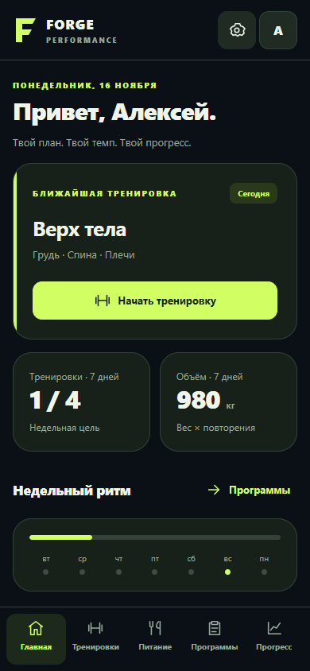 | 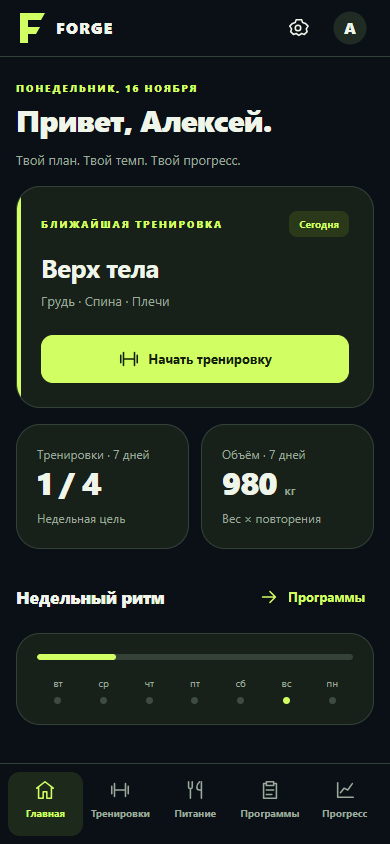 |
| Категории | 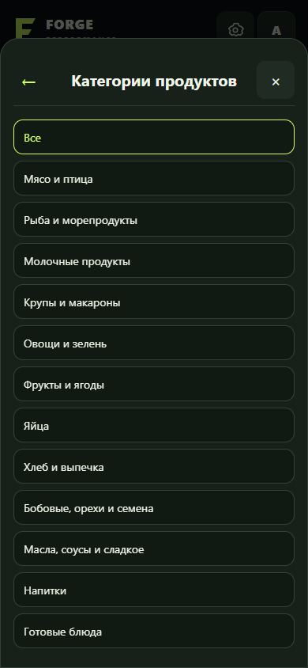 | 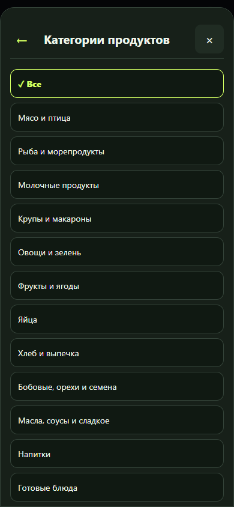 |
| Активная тренировка | 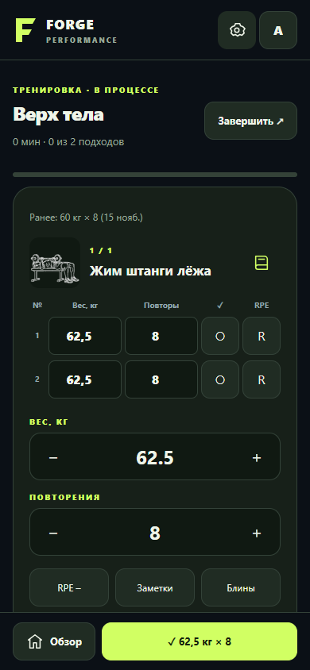 | 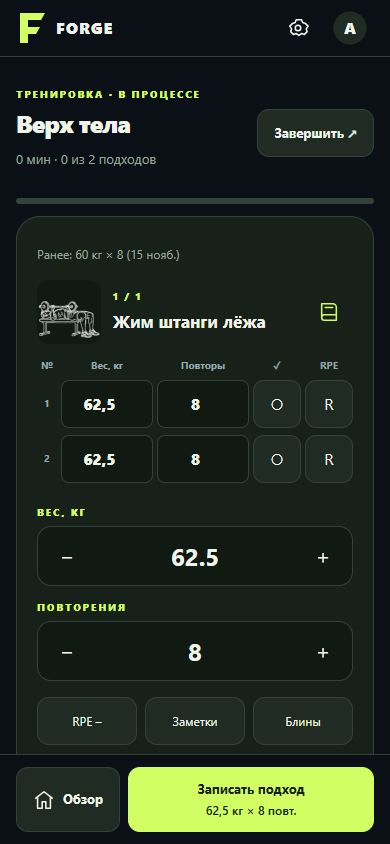 |
| Редактор программы | 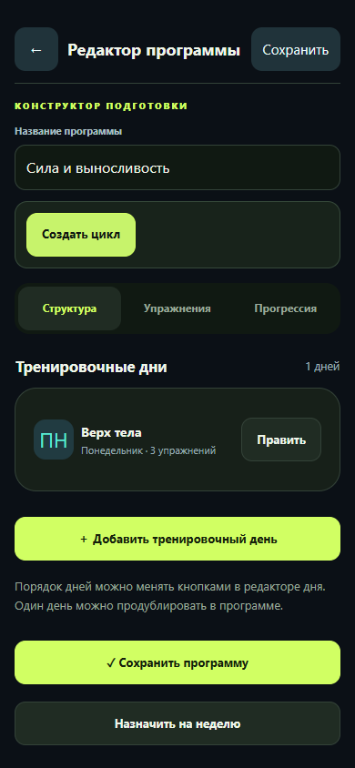 | 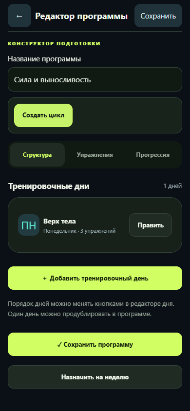 |
| Создание программы | 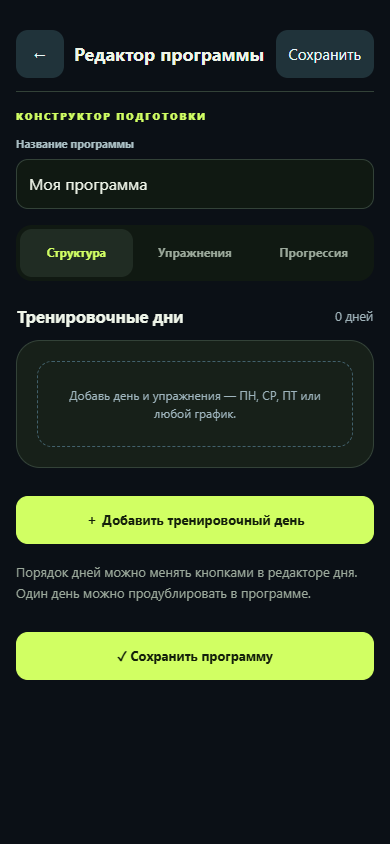 | 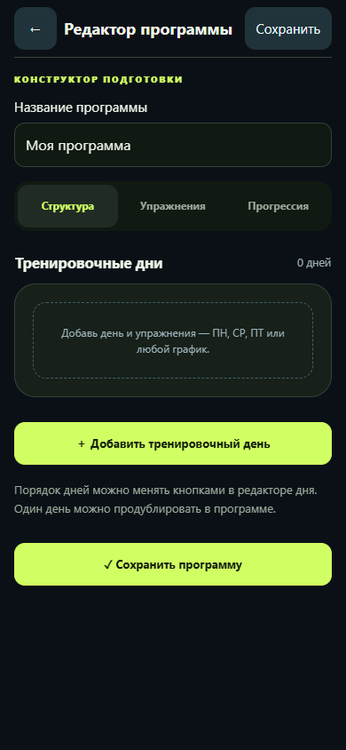 |
| Цикл | 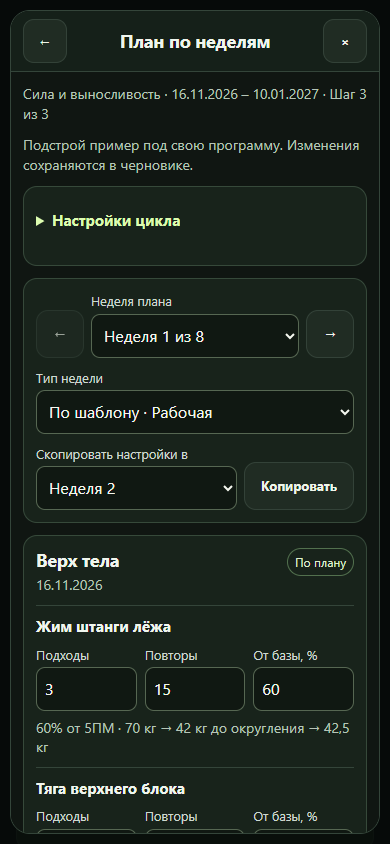 | 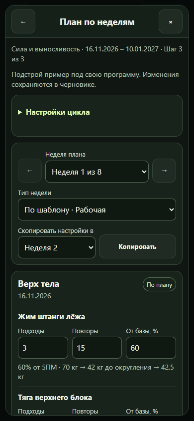 |
| Карточка упражнения |  | 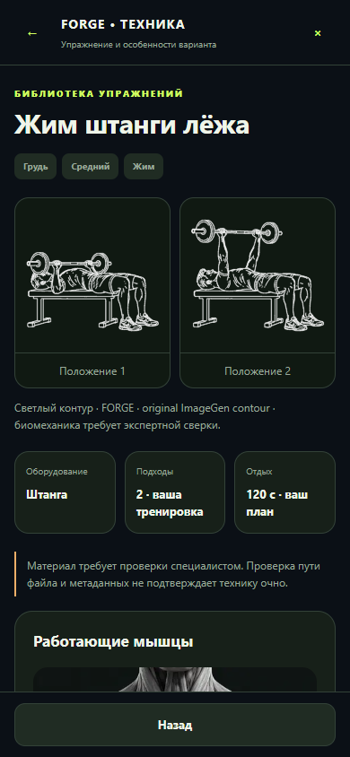 |
| Статистика | 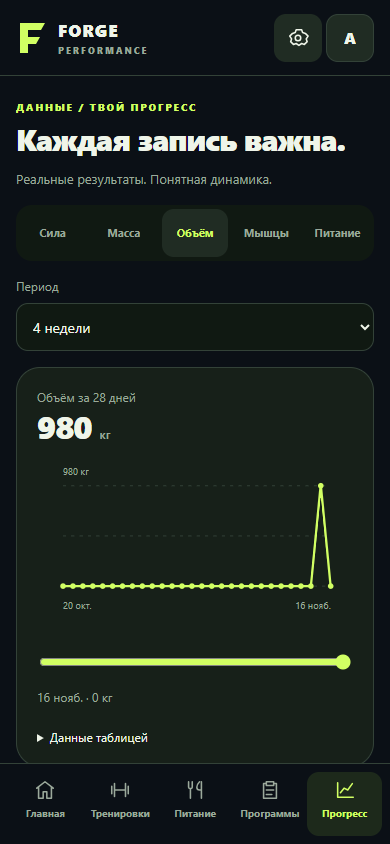 | 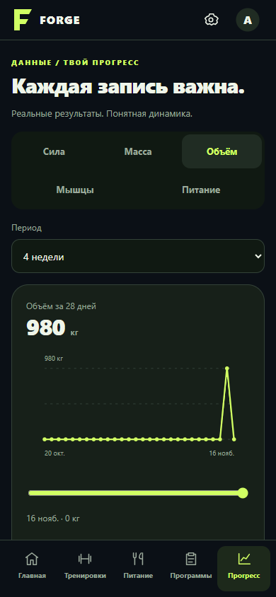 |

Главное действие тренировки теперь подписано словами «Записать подход», вес и единица указаны ниже. Верхняя панель занимает меньше места, её области нажатия составляют минимум 48×48 px. Обновлены переносы длинных текстов и команды в сложных редакторах. RPE/RIR раскрываются по запросу пользователя.

## Изменение числа действий

| Сценарий | До | После |
|---|---:|---:|
| Питание → продукты → запрос → выбор продукта → масса → добавить | 6 | 6 |
| Переключение основного источника | 1 | 1 |
| Открыть полный список категорий → выбрать | 2 | 2 |
| Ввести вес → ввести повторения → записать | 3 | 3 |
| Открыть создание сохраняемого продукта из каталога | 1 | 2 |

Дополнительное раскрытие для создания сохраняемого продукта освобождает основную область от нескольких равнозначных кнопок. Доступ к продуктам, рационам и ручной записи сохранён. Время выполнения человеком не измерялось.

Проверки включают видимость полного текста, отсутствие горизонтального выхода и пересечений, доступность контролов после прокрутки и сохранение данных. В [аудите](UX_AUDIT_V2.md) приведены воспроизведение, причины, статусы и перечень физических проверок.
